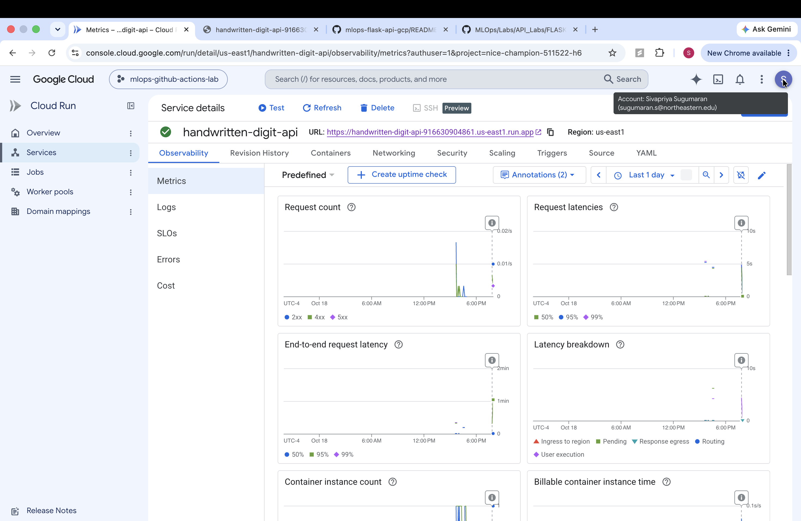
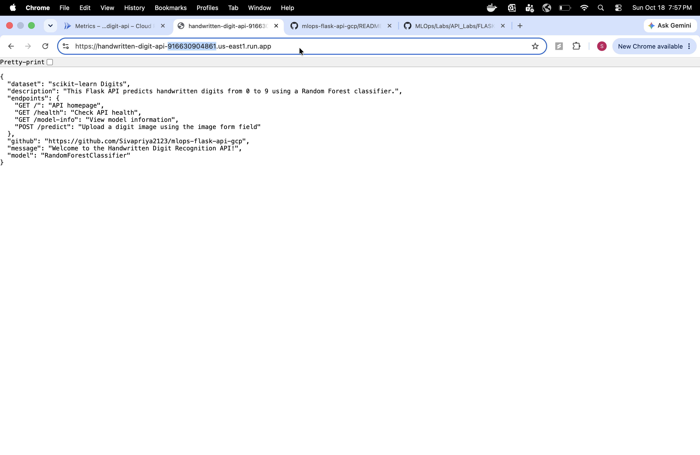
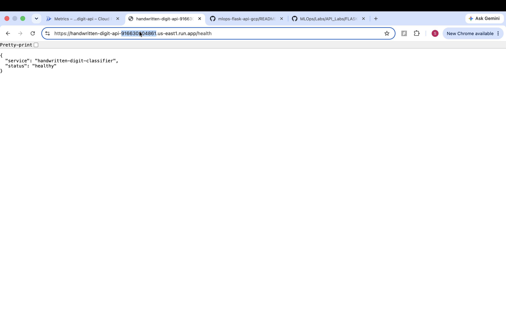
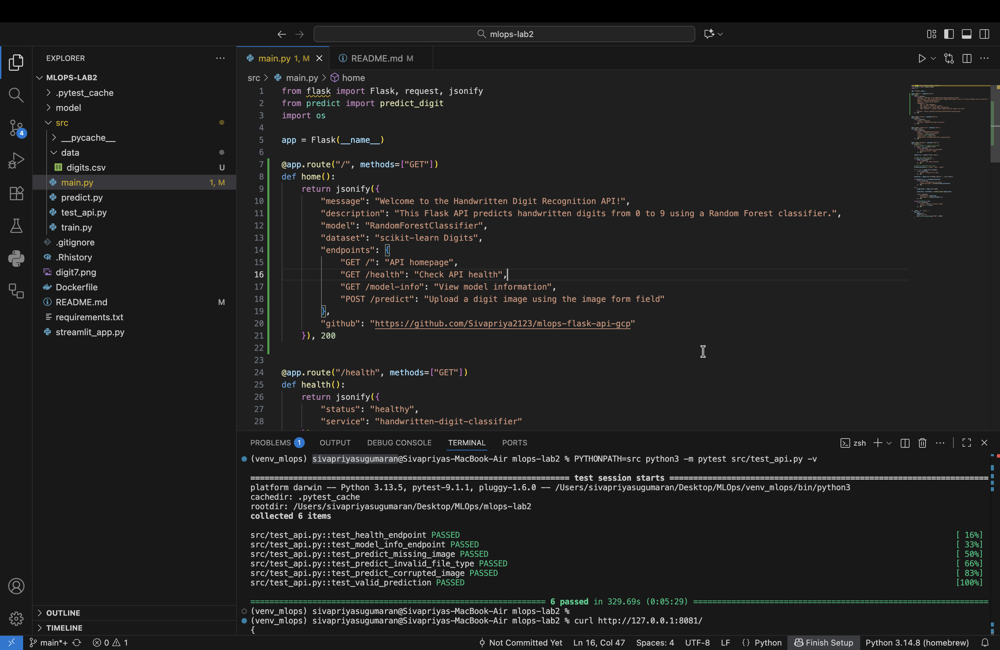
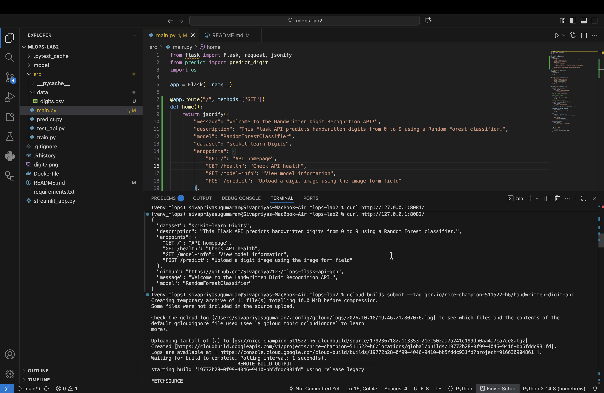
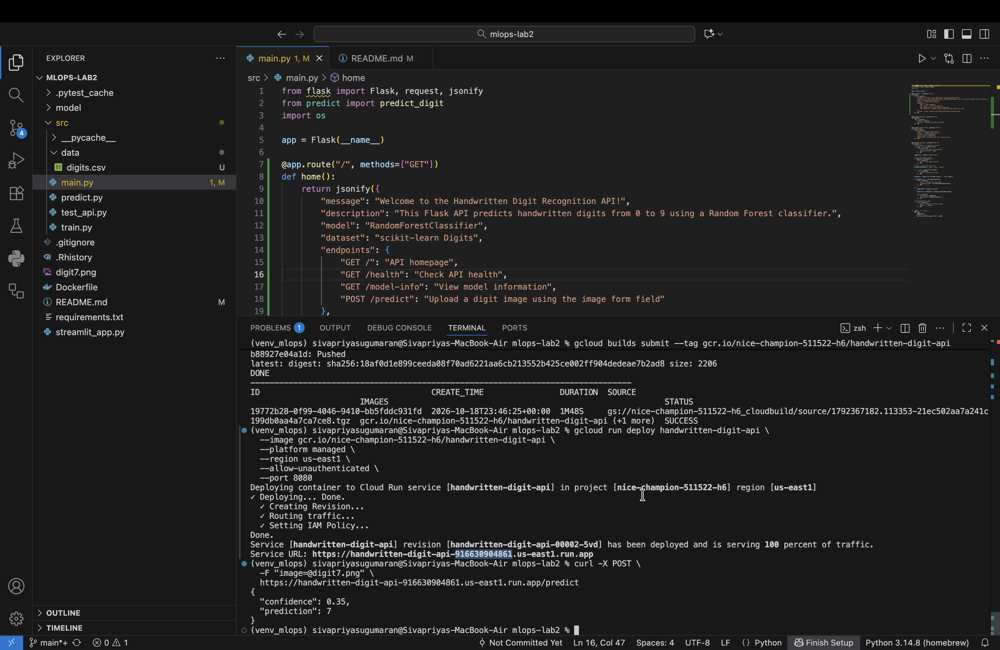
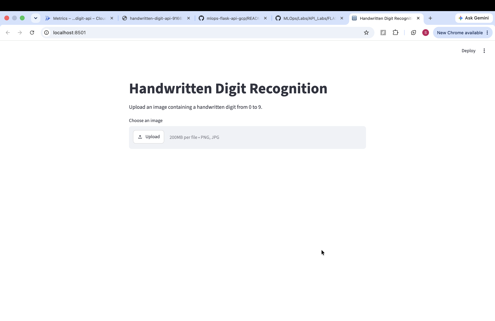
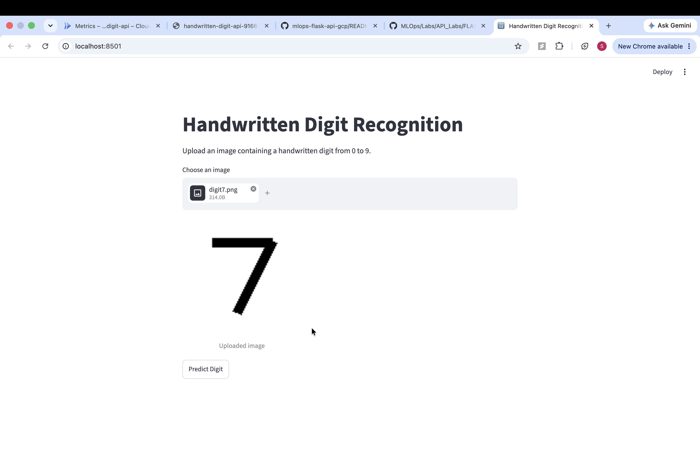
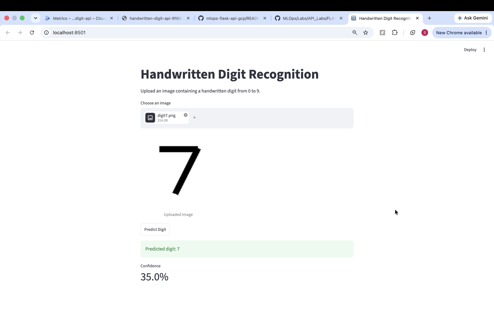

# Handwritten Digit Recognition API with Flask, Docker, and Google Cloud Run

## Project Overview

This project is a modified version of the original Flask GCP lab. Instead of serving an Iris flower classifier that predicts a flower species from four numeric measurements, it provides a handwritten digit recognition API that accepts an image of a digit from 0 to 9 and returns a predicted digit and confidence score.

The modifications extend beyond changing the dataset and model. This project includes image preprocessing, API input validation, a homepage and metadata endpoints, automated Flask tests, a Docker health check, a Streamlit frontend, and deployment to Google Cloud Run.

**GitHub repository:** https://github.com/Sivapriya2123/mlops-flask-api-gcp

**Deployed API:** https://handwritten-digit-api-916630904861.us-east1.run.app/

## Architecture

```text
Handwritten digit image
        |
        v
Streamlit frontend (local web application)
        |
        | HTTP POST /predict
        v
Google Cloud Run (Docker container)
        |
        v
Flask API: input validation
        |
        v
Image preprocessing (8x8 grayscale features)
        |
        v
Trained Random Forest classifier
        |
        v
JSON: prediction and confidence
        |
        v
Streamlit displays the result
```

The Flask API runs inside a Docker container deployed to Google Cloud Run. The Streamlit interface runs locally and sends images to the deployed API.

## Main Components

### Model Training

The model is trained on the scikit-learn handwritten digits dataset using `sklearn.datasets.load_digits()`.

| Property | Value |
| --- | --- |
| Dataset | scikit-learn Digits |
| Samples | 1,797 |
| Digit classes | 10 (0 through 9) |
| Image size | 8x8 grayscale |
| Input features | 64 |
| Model | `RandomForestClassifier` |
| Observed test accuracy | Approximately 96.4% |
| Saved model | `model/digit_model.pkl` |

Training is implemented in `src/train.py`. It loads the dataset, trains and evaluates the classifier, and saves the trained model as a `.pkl` file.

### Dataset and CSV Export

The original lab used Iris data. This version uses handwritten digit data instead. The unused `src/data/IRIS.csv` was removed and replaced with:

```text
src/data/digits.csv
```

The CSV contains **1,797 data rows and 65 columns**: `pixel_0` through `pixel_63` plus a `label` column containing the correct digit.

**Important:** `digits.csv` is included for inspection and reference. Model training still reads directly from `load_digits()` in scikit-learn. The training script does not require the CSV.

### Image Preprocessing and Prediction

The prediction pipeline in `src/predict.py` prepares uploaded images for the classifier. It converts an image into grayscale, resizes it to 8x8, adjusts pixel polarity and scale, and flattens it into 64 numeric input features. The classifier predicts the digit and returns a confidence value using class probabilities.

The example image `digit7.png` produced digit **7** with confidence **0.35 (35%)** during testing. This value is a model confidence score for that prediction, not the overall test accuracy of the classifier.

### API Endpoints

The API is implemented in `src/main.py`.

| Method | Endpoint | Purpose |
| --- | --- | --- |
| GET | `/` | Welcome message, model and dataset information, and available endpoints |
| GET | `/health` | Check whether the API responds successfully |
| GET | `/model-info` | Describe the classifier, dataset, classes, and input format |
| POST | `/predict` | Accept an uploaded digit image and return a prediction |

#### Homepage

Open the public root URL:

https://handwritten-digit-api-916630904861.us-east1.run.app/

The homepage returns JSON containing a welcome message, model name, dataset, endpoint descriptions, and GitHub repository link. The root route was added so opening the service URL no longer returns a `404 Not Found` response.

#### Health Check

Request:

```http
GET /health
```

Example response:

```json
{
  "service": "handwritten-digit-classifier",
  "status": "healthy"
}
```

#### Model Information

Request:

```http
GET /model-info
```

Example response:

```json
{
  "model": "RandomForestClassifier",
  "dataset": "scikit-learn digits",
  "classes": [0, 1, 2, 3, 4, 5, 6, 7, 8, 9],
  "input_format": "image file",
  "image_size": "8x8 grayscale after preprocessing"
}
```

#### Prediction

Request:

```http
POST /predict
```

Submit the image as a multipart form upload with the field name `image`. Supported image extensions include PNG, JPG, and JPEG. The API checks for missing files, unsupported types, and corrupted images, and uses HTTP 400 responses for invalid input.

Example response:

```json
{
  "prediction": 7,
  "confidence": 0.35
}
```

**Note:** `/predict` requires a POST request with an image file. Opening `/predict` directly in a browser sends a GET request and returns `405 Method Not Allowed`, which is expected.

## Project Structure

```text
mlops-flask-api-gcp/
├── model/
│   └── digit_model.pkl
├── src/
│   ├── data/
│   │   └── digits.csv
│   ├── main.py
│   ├── predict.py
│   ├── test_api.py
│   └── train.py
├── screenshots/
│   ├── 01-cloud-run-metrics.png
│   ├── 02-api-homepage.png
│   ├── 03-api-health.png
│   ├── 04-pytest-results.png
│   ├── 05-local-api-test.png
│   ├── 06-cloud-build.png
│   ├── 07-cloud-deployment-prediction.png
│   ├── 08-streamlit-upload.png
│   └── 09-streamlit-prediction.png
├── .gitignore
├── Dockerfile
├── README.md
├── requirements.txt
├── streamlit_app.py
└── digit7.png
```

The folder is named `mlops-lab2` on the development machine. When cloned from GitHub, its default folder name is `mlops-flask-api-gcp`.

## Prerequisites

- Python 3.11 or later (the Docker image uses `python:3.11-slim`)
- Git
- Docker Desktop, running locally
- Google Cloud CLI (`gcloud`) for cloud build and deployment
- A Google Cloud project with appropriate billing and permissions for cloud deployment

Check the installed tools:

```bash
python3 --version
git --version
docker --version
gcloud --version
```

## Environment Setup

Clone the repository:

```bash
git clone https://github.com/Sivapriya2123/mlops-flask-api-gcp.git
cd mlops-flask-api-gcp
```

Create a virtual environment:

```bash
python3 -m venv venv
```

Activate it on macOS or Linux:

```bash
source venv/bin/activate
```

On Windows PowerShell:

```powershell
.\venv\Scripts\Activate.ps1
```

Install the project dependencies:

```bash
python -m pip install -r requirements.txt
```

For the optional Streamlit frontend, ensure Streamlit is installed. If it is not in the environment, run:

```bash
python -m pip install streamlit
```

## Model Training

From the project root, run:

```bash
python src/train.py
```

The output should be similar to:

```text
Dataset shape: (1797, 64)
Number of classes: 10
Model accuracy: 0.9639
Saved trained model to model/digit_model.pkl
```

Confirm that the model file exists:

```bash
ls -lh model
```

Training uses `load_digits()` directly. The included CSV is not read by the training script.

## Run the Flask API Locally

From the project root:

```bash
python src/main.py
```

By default, the service is available at:

http://127.0.0.1:8080/

If port 8080 is already in use, choose another local port, for example:

```bash
PORT=8081 python src/main.py
```

Then visit `http://127.0.0.1:8081/`. The Flask development server is for local testing, not production hosting.

## Test the API Locally

In a separate terminal, with Flask running on port 8080:

### Homepage

```bash
curl http://127.0.0.1:8080/
```

### Health Endpoint

```bash
curl http://127.0.0.1:8080/health
```

### Model Information

```bash
curl http://127.0.0.1:8080/model-info
```

### Prediction

From the project root, where `digit7.png` is located:

```bash
curl -X POST \
  -F "image=@digit7.png" \
  http://127.0.0.1:8080/predict
```

Example response:

```json
{
  "confidence": 0.35,
  "prediction": 7
}
```

If you started the app on port 8081, replace `8080` with `8081` in the local test URLs.

## Automated Testing

Automated tests are in `src/test_api.py`. They cover:

1. The `/health` endpoint
2. The `/model-info` endpoint
3. Requests missing an image
4. Unsupported image file types
5. Corrupted image uploads
6. Valid digit prediction

Run from the project root with the virtual environment activated:

```bash
PYTHONPATH=src python -m pytest src/test_api.py -v
```

The verified local test run completed successfully:

```text
src/test_api.py::test_health_endpoint PASSED
src/test_api.py::test_model_info_endpoint PASSED
src/test_api.py::test_predict_missing_image PASSED
src/test_api.py::test_predict_invalid_file_type PASSED
src/test_api.py::test_predict_corrupted_image PASSED
src/test_api.py::test_valid_prediction PASSED

6 passed
```

## Docker

### Build Docker Image

Make sure Docker Desktop is running. From the project root:

```bash
docker build -t handwritten-digit-api .
```

The Dockerfile uses the `python:3.11-slim` base image, installs dependencies, copies the trained model and Flask source code, configures port 8080, and includes a health check that calls `/health`.

### Run the Container Locally

```bash
docker run --rm -p 8080:8080 handwritten-digit-api
```

Visit `http://127.0.0.1:8080/` in your browser. If Mac port 8080 is occupied, use:

```bash
docker run --rm -p 8082:8080 handwritten-digit-api
```

Then visit `http://127.0.0.1:8082/`.

In Docker's `-p 8082:8080` mapping, `8082` is the host (Mac) port and `8080` is the container port. This does not change the Cloud Run container port.

### Docker Health Check

The container checks `GET /health` to detect whether the Flask service is responding. Local testing confirmed successful homepage and health requests inside Docker.

## Google Cloud Setup

Authenticate and initialize the Google Cloud CLI:

```bash
gcloud auth login
gcloud init
```

Select the Google Cloud project used for this deployment:

```bash
gcloud config set project nice-champion-511522-h6
gcloud config get-value project
```

Enable the required APIs:

```bash
gcloud services enable cloudbuild.googleapis.com
gcloud services enable run.googleapis.com
gcloud services enable artifactregistry.googleapis.com
```

Verify the enabled services:

```bash
gcloud services list --enabled --filter="NAME:(cloudbuild.googleapis.com OR run.googleapis.com OR artifactregistry.googleapis.com)"
```

The project previously encountered a Cloud Build source-object permissions issue, which was resolved before successfully building and deploying the container.

## Build the Container in Google Cloud

From the project root:

```bash
gcloud builds submit --tag gcr.io/nice-champion-511522-h6/handwritten-digit-api
```

The observed build finished with `STATUS: SUCCESS` and pushed the container image successfully.

## Deploy to Google Cloud Run

```bash
gcloud run deploy handwritten-digit-api \
  --image gcr.io/nice-champion-511522-h6/handwritten-digit-api \
  --platform managed \
  --region us-east1 \
  --allow-unauthenticated \
  --port 8080
```

The deployment was completed successfully in `us-east1`. The updated revision was deployed and received 100% of the service traffic.

**Service URL:** https://handwritten-digit-api-916630904861.us-east1.run.app/

**Port note:** Cloud Run uses container port `8080`. Local testing with host ports such as `8081` and `8082` does not require changing the Cloud Run deployment command.

## Test the Deployed Cloud Run API

### Homepage

Open in a browser:

https://handwritten-digit-api-916630904861.us-east1.run.app/

Or run:

```bash
curl https://handwritten-digit-api-916630904861.us-east1.run.app/
```

The response contains the welcome message, dataset, model, and endpoint descriptions.

### Health

```bash
curl https://handwritten-digit-api-916630904861.us-east1.run.app/health
```

Expected response:

```json
{
  "service": "handwritten-digit-classifier",
  "status": "healthy"
}
```

### Model Information

```bash
curl https://handwritten-digit-api-916630904861.us-east1.run.app/model-info
```

### Prediction

Run from the project root:

```bash
curl -X POST \
  -F "image=@digit7.png" \
  https://handwritten-digit-api-916630904861.us-east1.run.app/predict
```

Observed response:

```json
{
  "confidence": 0.35,
  "prediction": 7
}
```

These checks verified that the publicly accessible Cloud Run service responded to the homepage, health, and prediction requests at the time of testing.

## Streamlit Frontend

The project includes `streamlit_app.py`, a local frontend for uploading images and viewing predictions from the deployed Flask API.

Start the frontend from the project root:

```bash
python -m streamlit run streamlit_app.py
```

If the `streamlit` module is missing, install it in the active virtual environment:

```bash
python -m pip install streamlit
```

Open:

http://localhost:8501

Click **Upload**, select `digit7.png`, and then click **Predict Digit**. The verified result was:

```text
Predicted digit: 7
Confidence: 35.0%
```

Streamlit runs on the local machine, while the prediction is requested from the deployed Flask API on Google Cloud Run. The Streamlit interface itself is not deployed by the `gcloud run deploy` command above.

## Meaningful Changes Made to the Original Lab

The original Flask GCP lab accepted four numeric Iris flower measurements and predicted a flower category. This version changes the data format and the model-serving workflow.

| Original Flask GCP Lab | Modified Project |
| --- | --- |
| Iris flower dataset | scikit-learn handwritten Digits dataset |
| Four numeric measurements | Uploaded handwritten digit image |
| Iris classification model | Random Forest digit classifier |
| Flower class prediction | Digit (0 to 9) plus confidence |
| Basic prediction endpoint | Prediction, homepage, health, and model-info endpoints |
| Original input handling | Grayscale and 8x8 image preprocessing |
| Original API behavior | File validation and HTTP 400 error handling |
| Basic lab testing | Six automated API tests |
| Base container configuration | Updated Docker image with health check |
| Original sample data file | Removed `IRIS.csv`; exported `src/data/digits.csv` for reference |
| API-oriented interaction | Added Streamlit image-upload frontend |
| Lab deployment flow | Successfully built and deployed modified service to Cloud Run |

Additional improvements include clearer README setup instructions, reproducible API test commands, and deployment screenshots for grading verification.

## Deployment and Testing Evidence

The screenshots in this section document the local tests, Cloud Build, Cloud Run deployment, public API responses, and Streamlit prediction demonstrated during development.

### 1. Google Cloud Run Metrics

The Cloud Run console displays the deployed service and request activity.



### 2. Deployed API Homepage

The public root URL displays the welcome message, dataset, classifier, and endpoint descriptions instead of a 404 response.



### 3. Deployed API Health Check

The `/health` endpoint returns `"status": "healthy"`.



### 4. Automated API Test Results

All six automated Flask API tests passed.



### 5. Local API Test

The Flask homepage was tested locally before deployment.



### 6. Google Cloud Build

The updated Docker image was built and pushed successfully using Google Cloud Build.



### 7. Cloud Run Deployment and Prediction

The updated service was successfully deployed, and the prediction endpoint returned digit 7 with confidence 0.35.



### 8. Streamlit Image Upload

The Streamlit interface displays the uploaded sample digit image.



### 9. Streamlit Prediction Result

The frontend displays digit 7 and a confidence score of 35.0%.



## Grading and Deployment Availability

This project was deployed and tested successfully on Google Cloud Run. The public service URL, API request commands, local Docker instructions, automated tests, and screenshots are provided above so a grader can verify the work without needing access to my Google Cloud Console.

**Deployed API:** https://handwritten-digit-api-916630904861.us-east1.run.app/

**Note for Graders:** If the Cloud Run endpoint is unavailable during grading, please contact me(sugumaran.s@northeastern.edu) to arrange verification. Deployment and testing screenshots are provided above.

## Successful End-to-End Workflow

1. A user uploads an image of a handwritten digit in the Streamlit frontend.
2. Streamlit sends the image as a multipart `POST /predict` request to the Cloud Run URL.
3. The Flask API validates the uploaded file.
4. The prediction module preprocesses the image to 64 numeric features.
5. The trained Random Forest classifier predicts the digit and computes a confidence score.
6. Flask returns the prediction and confidence as JSON.
7. Streamlit displays the predicted digit and confidence to the user.

The project was tested locally, inside Docker, and through its deployed Cloud Run API. The sample image `digit7.png` produced digit 7 with 35% confidence.
